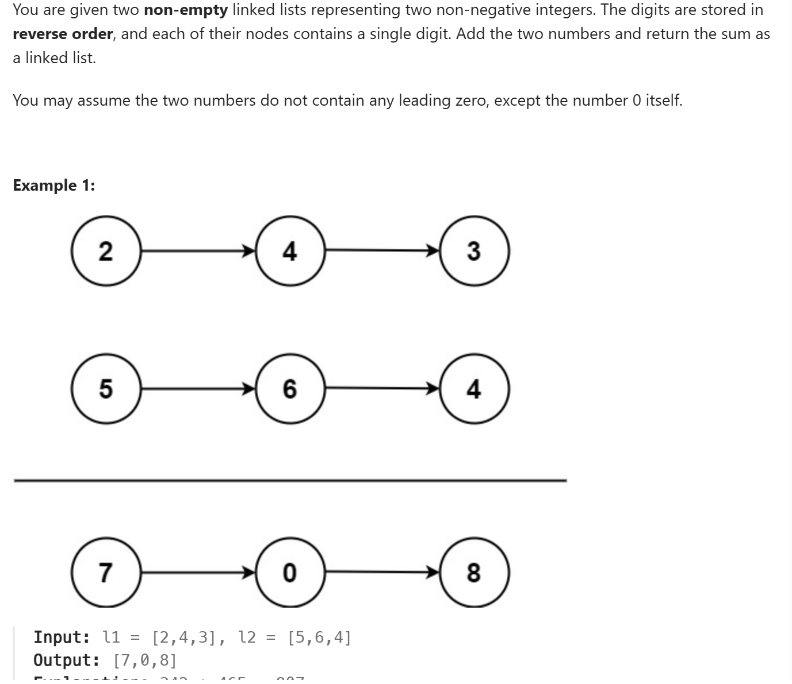
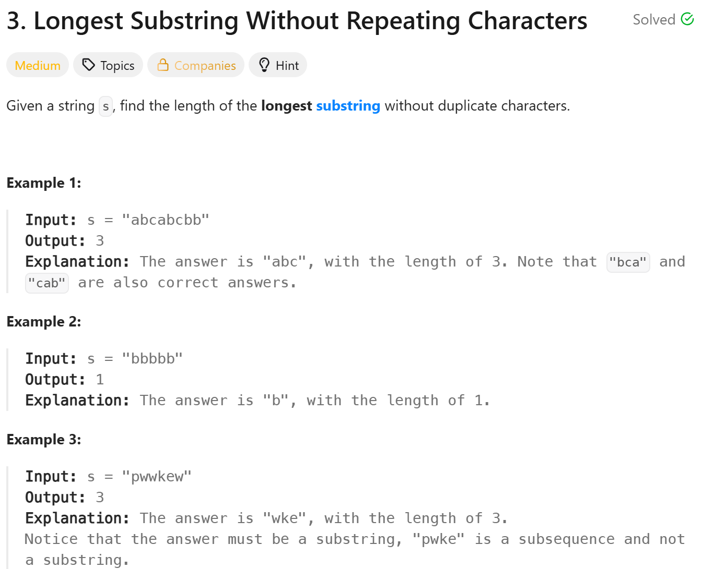
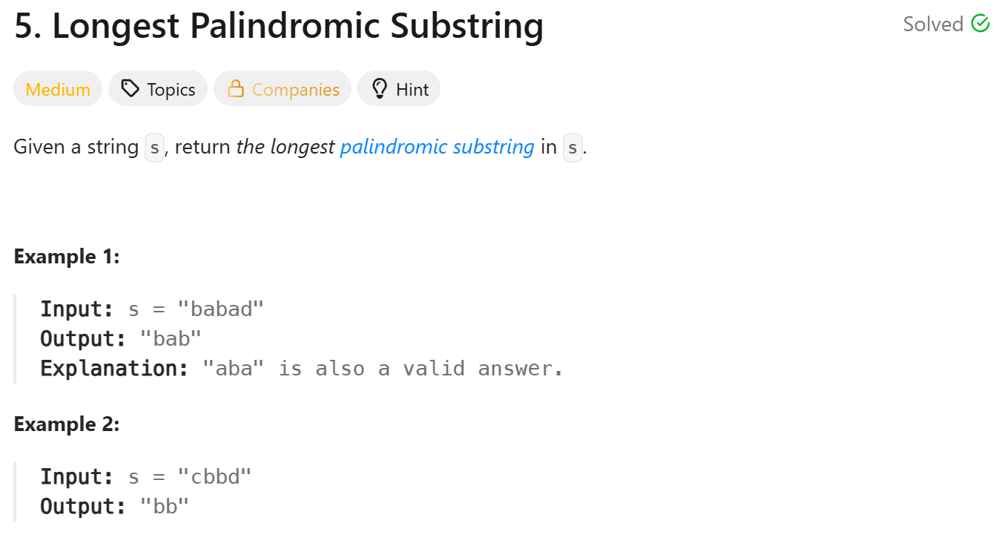
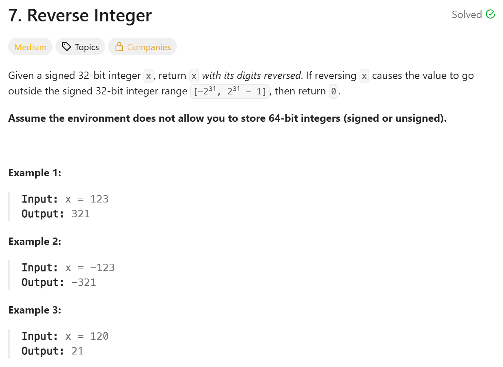
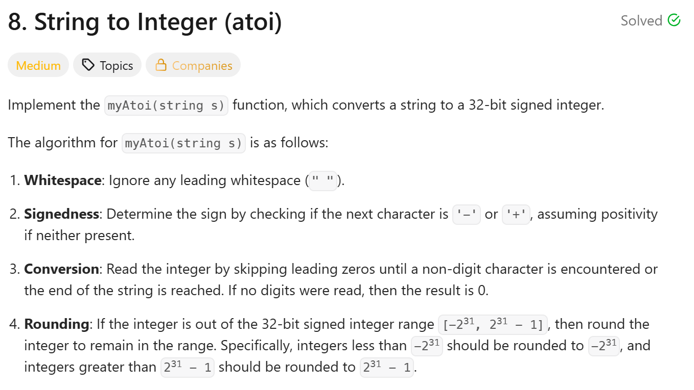
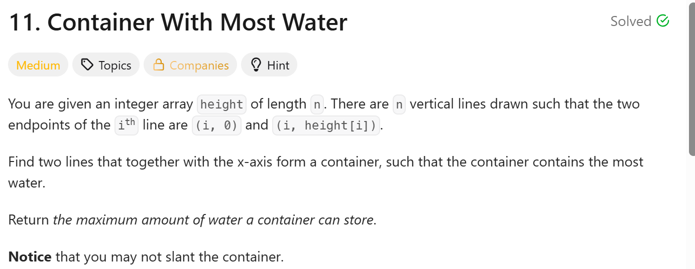
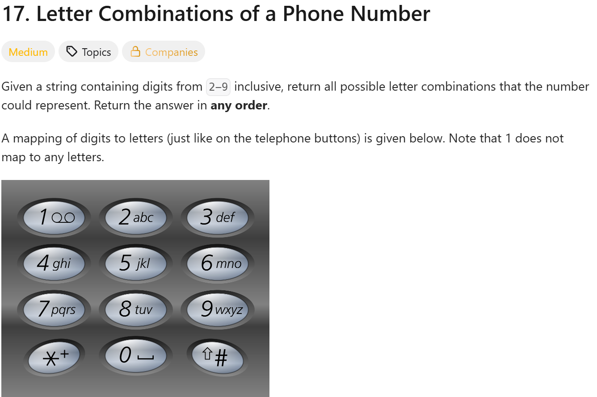
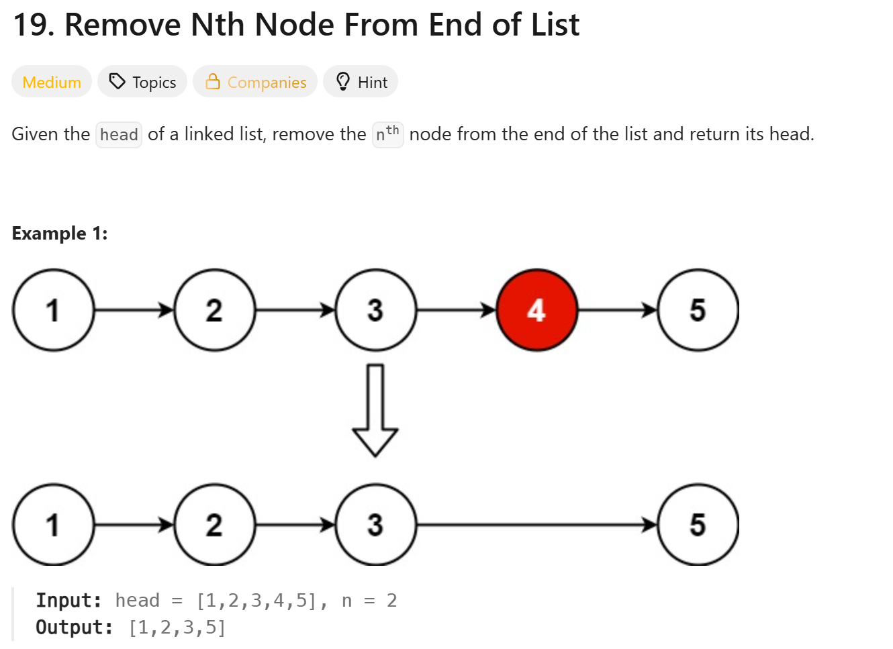

## 1.Two Sum


```python
from typing import List
class Solution:
    '''设新字典{数字:索引}，遍历数组，
    用target-当前数字得到需要的数字，如果这个需要的数字在字典里，说明之前出现过这个数字，返回它的索引和当前索引；
    否则就把当前数字和索引加入字典'''
    def twoSum(self, nums: List[int], target: int) -> List[int]:
        n = len(nums)
        dic = {}
        for i in range(0,n):
            need = target - nums[i]
            if need in dic:
                return [dic[need], i]
            else:
                dic[nums[i]] = i

```

## 2. Add Two Numbers


```python
# Definition for singly-linked list.
from typing import Optional
class ListNode:
    def __init__(self, val=0, next=None):
        self.val = val
        self.next = next
    
class Solution:
    def addTwoNumbers(self, l1: Optional[ListNode], l2: Optional[ListNode]) -> Optional[ListNode]:
        result = ListNode()
        current = result
        flag = 0
        
        while l1 or l2 or flag:
            # 取当前值，没有就是0
            v1 = l1.val if l1 else 0
            v2 = l2.val if l2 else 0
            
            # 求和 + 进位
            total = v1 + v2 + flag
            flag = total // 10       # 新进位
            new_val = total % 10      # 当前位
            
            # 新建节点
            current.next = ListNode(new_val)
            current = current.next
            
            # 移动指针
            if l1:
                l1 = l1.next
            if l2:
                l2 = l2.next
        
        return result.next


class Solution:
    def addTwoNumbers(self, l1: Optional[ListNode], l2: Optional[ListNode]) -> Optional[ListNode]:
        result = ListNode()
        current = result
        flag = 0
        
        while l1 or l2 or flag:
            # 取当前值，没有就是0
            v1 = l1.val if l1 else 0
            v2 = l2.val if l2 else 0
            
            # 求和 + 进位
            total = v1 + v2 
            if flag == 1:
                flag = 0
                total += 1
            if total >= 10: # 新进位
                flag = 1
                total = total - 10
            current.next = ListNode(total)
            current = current.next
            
            # 移动指针
            if l1:
                l1 = l1.next
            if l2:
                l2 = l2.next
        
        return result.next

        
```

## 3. Longest Substring without Repeating Characters



```python
class Solution:
    def lengthOfLongestSubstring(self, s: str) -> int:
        lst = []
        n = 0
        for char in s:
            if char not in lst: ## 不在列表
                lst.append(char)
            else: ## 在列表
                ## 算数比大小
                now = len(lst)
                if now > n:
                    n = now
                ## 删除重复char之前的部分
                lst = lst[lst.index(char)+1:]
                lst.append(char)          
        return max(len(lst),n) ##防止最后一段就是最长
            
## 哈希表滑动窗口
## char_index字典，记录每个字符最后出现的位置
## 遍历字符串，right是当前字符索引，char是当前字符
## char再次出现在char_index中时，且索引在当前窗口内，说明有重复字符，更新左边界left为重复字符的下一个位置
## 更新char_index中当前字符的最新位置
class Solution:
    def lengthOfLongestSubstring(self, s: str) -> int:
        char_index = {}   # 记录字符最后出现的位置 {char:index}
        left = 0          # 窗口左边界
        max_len = 0       # 最长长度

        for right, char in enumerate(s):
            # 如果字符出现过，并且在当前窗口内
            if char in char_index and char_index[char] >= left:
                left = char_index[char] + 1  ## 左边界是重复字符的下一个位置

            # 更新字符最新位置
            char_index[char] = right

            # 更新最大长度
            max_len = max(max_len, right - left + 1)

        return max_len
```

## 4. Median of Two Sorted Arrays


mark 不会写！！

## 5. Longest Palindromic Substring


```python
class Solution:
    def longestPalindrome(self, s: str) -> str:
        res = ""
        
        for i in range(len(s)):
            # 奇数长度
            p1 = self.expand(s, i, i)
            # 偶数长度
            p2 = self.expand(s, i, i + 1)
            
            # 选最长的
            res = max(res, p1, p2, key=len)
        
        return res

    def expand(self, s, left, right):
        # 向两边扩
        while left >= 0 and right < len(s) and s[left] == s[right]:
            left -= 1
            right += 1
        
        # 返回回文子串
        return s[left + 1:right]
```

## 6. Zigzag Conversion


```python
class Solution:
    def convert(self, s: str, numRows: int) -> str:
        if numRows == 1:
            return s
        
        rows = [""] * numRows
        cur_row = 0
        direction = 1
        
        for c in s:
            rows[cur_row] += c
            
            if cur_row == 0:
                direction = 1
            elif cur_row == numRows - 1:
                direction = -1
            
            cur_row += direction
        
        return "".join(rows)
```

## 7. Reverse Integer


```python
class Solution:
    def reverse(self, x: int) -> int:
        # 存翻转后的数字
        res = 0

        # 处理符号：如果x为负数，sign=-1；否则sign=1
        sign = -1 if x < 0 else 1

        # 取绝对值，方便统一处理数字，最后再乘以符号
        x = abs(x)
        
        # 核心循环：只要x不为0，就继续处理
        while x != 0:
            # 取x的最后一位数字
            digit = x % 10

            # 将数字拼接到res后面
            # res*10表示左移一位（原来的数字向高位移动），再加上当前digit
            res = res * 10 + digit

            # 去掉x的最后一位数字（整除10）
            x //= 10
        
        # 恢复原来的符号
        res *= sign

        # 如果超出[-2^31, 2^31-1]，返回0
        if res < -2**31 or res > 2**31 - 1:
            return 0
        
        # 返回翻转后的结果
        return res
```

## 8. String To Integer


```python
class Solution:
    def myAtoi(self, s: str) -> int:
        # 1️⃣ 忽略开头空格
        s = s.lstrip()  # 去掉左边所有空格
        if not s:  # 如果去掉空格后空字符串，直接返回0
            return 0
        
        # 2️⃣ 判断符号
        sign = 1  # 默认正数
        i = 0     # 当前扫描的索引
        if s[0] == '-':
            sign = -1
            i += 1
        elif s[0] == '+':
            i += 1
        
        # 3️⃣ 开始读取数字
        res = 0
        while i < len(s) and s[i].isdigit():
            digit = int(s[i])
            res = res * 10 + digit
            i += 1
        
        # 4️⃣ 加上符号
        res *= sign
        
        # 5️⃣ 溢出处理，限制在32位有符号整数范围
        INT_MIN = -2**31
        INT_MAX = 2**31 - 1
        if res < INT_MIN:
            return INT_MIN
        if res > INT_MAX:
            return INT_MAX
        
        # 6️⃣ 返回结果
        return res
```
[' ', ' ', ' ', '-', '0', '4', '2']
[' ', '-', '0', '4', '2']


## 9. Palindrome Number


```python
class Solution:
    def isPalindrome(self, x: int) -> bool:
        if x<0:  ## 负数不是回文数
            return False 
        temp = abs(x)
        rev_nums = 0
        while temp != 0:
            digit = temp%10
            rev_nums = rev_nums * 10 + digit
            temp //= 10
        if rev_nums == x:
            return True
        else:
            return False
        
```

## 10. Regular Expression Matching


```python
class Solution:
    def isMatch(self, s: str, p: str) -> bool:
        # 用记忆化，避免重复计算
        memo = {}

        def dfs(i, j):
            """
            i：当前匹配到 s 的位置
            j：当前匹配到 p 的位置
            返回：s[i:] 是否能被 p[j:] 匹配
            """

            # 如果计算过，直接返回（剪枝优化）
            if (i, j) in memo:
                return memo[(i, j)]

            # 如果 p 用完了，看 s 是否也用完
            if j == len(p):
                return i == len(s)

            # 判断当前字符是否匹配
            first_match = (
                i < len(s) and 
                (p[j] == s[i] or p[j] == '.')
            )

            # ⭐ 处理 '*'（重点！！）
            if j + 1 < len(p) and p[j + 1] == '*':
                # 两种情况：
                # 1️⃣ 不用这个字符（跳过 p[j] 和 '*'）
                # 2️⃣ 用这个字符（如果匹配，就继续匹配下一个 s）
                res = dfs(i, j + 2) or (first_match and dfs(i + 1, j))
            else:
                # 普通情况：当前匹配，就一起往后走
                res = first_match and dfs(i + 1, j + 1)

            # 存入记忆
            memo[(i, j)] = res
            return res

        return dfs(0, 0)
```

## 11. Container with Most Water


```python
from typing import List
def maxArea(height: List[int]) -> int:
    s = 0
    left = 0
    right = len(height) - 1
    while left < right:
        s = max(s, (right - left) * min(height[left], height[right]))
        ## 谁矮谁往中间靠
        if height[left] < height[right]:
            left += 1
        else:
            right -= 1
    return s
       
maxArea([1,8,6,2,5,4,8,3,7])
```

## 12. Integer to Roman

```python
class Solution:
    def intToRoman(self, num: int) -> str:
        # 1️⃣ 定义数值和对应罗马字符（必须从大到小排列）
        values = [
            (1000, "M"),(900, "CM"),(500, "D"),(400, "CD"),(100, "C"),
            (90, "XC"),(50, "L"),(40, "XL"),(10, "X"),(9, "IX"),(5, "V"),
            (4, "IV"),(1, "I")
        ]
        
        # 2️⃣ 初始化结果字符串
        res = ""
        
        # 3️⃣ 从大到小遍历
        for val, symbol in values:
            # 只要当前数字 >= val，就一直用这个符号
            while num >= val:
                res += symbol      # 拼接罗马字符
                num -= val         # 减去对应数值
        
        # 4️⃣ 返回结果
        return res
```

```python

def intToRoman( num: int) -> str:
    nums = [0,0,0,0]
    nums[3] = num%10 #个位
    nums[0] = num//1000%10
    nums[1] = num//100%10
    nums[2] = num//10%10
    result = []
    for idx,n in enumerate(nums):
        if idx == 0:
            result.append('M' * n)
        
        if idx == 1:
            if n < 4:
                result.append('C' * n)
            elif n == 4:
                result.append('CD')
            elif n > 4 and n < 9:
                result.append('D'+'C'*(n-5))
            elif n == 9:
                result.append('CM')
            else:
                result.append('')
        if idx == 2:
            if n < 4:
                result.append('X' * n)
            elif n == 4:
                result.append('XL')
            elif n > 4 and n < 9:
                result.append('L'+'X'*(n-5))
            elif n == 9:
                result.append('XC')
            else:
                result.append('')
        if idx == 3:
            if n < 4:
                result.append('I' * n)  
            elif n == 4:
                result.append('IV')
            elif n > 4 and n < 9:
                result.append('V'+'I'*(n-5))
            elif n == 9:
                result.append('IX')
            else:
                result.append('')
    # print(result)
    return (result[0]+result[1]+result[2]+result[3])

intToRoman(3749)
            
```
['MMM', 'DCC', 'XL', 'IX']


## 13. Roman to Integer

```python
class Solution:
    def romanToInt(self, s: str) -> int:
        values = {
            'I': 1, 'V': 5, 'X': 10,
            'L': 50, 'C': 100,
            'D': 500, 'M': 1000
        }
        result = 0
        for i in range(len(s)):
            if i < len(s)-1 and values[s[i]] < values[s[i+1]]: ## 如果当前值小于下一个值，需要减去
                result -= values[s[i]]
            else:
                result += values[s[i]]
        return result
```

## 14. Longest Common Prefix


```python
from typing import List
class Solution:
    def longestCommonPrefix(self, strs: List[str]) -> str:
        # 如果是空数组
        if not strs:
            return ""
        
        # 以第一个字符串作为参考
        prefix = strs[0]
        
        # 遍历后面的字符串
        for s in strs[1:]:
            # 如果当前字符串不以 prefix 开头，就缩短 prefix
            while not s.startswith(prefix):
                prefix = prefix[:-1]  # 去掉最后一个字符
                
                if prefix == "":
                    return ""
        
        return prefix
```

## 15. Three Sum


```python
class Solution:
    def threeSum(self, nums: list[int]) -> list[list[int]]:
        nums.sort()  # 1️⃣ 排序
        result = []
        
        for i in range(len(nums)):
            # 2️⃣ 跳过重复的 i
            if i > 0 and nums[i] == nums[i-1]:
                continue
            
            left = i + 1
            right = len(nums) - 1
            
            while left < right:
                total = nums[i] + nums[left] + nums[right]
                
                if total == 0:
                    result.append([nums[i], nums[left], nums[right]])
                    
                    # 3️⃣ 去重
                    while left < right and nums[left] == nums[left+1]:
                        left += 1
                    while left < right and nums[right] == nums[right-1]:
                        right -= 1
                    
                    left += 1
                    right -= 1
                
                elif total < 0:
                    left += 1   # 太小 → 变大
                
                else:
                    right -= 1  # 太大 → 变小
        
        return result
```

## 16. Three Sum Closest


```python
from typing import List
class Solution:
    def threeSumClosest(self, nums: List[int], target: int) -> int:
        nums.sort()  # 先排序
        closest = float('inf')  # 保存最接近的差值
        result = 0  # 最接近的三数和

        for i in range(len(nums) - 2):
            left = i + 1
            right = len(nums) - 1

            while left < right:
                total = nums[i] + nums[left] + nums[right]
                diff = abs(total - target)

                # 更新最接近的结果
                if diff < closest:
                    closest = diff
                    result = total

                # 如果正好等于目标，直接返回
                if total == target:
                    return total
                elif total < target:
                    left += 1  # 和太小 → 左指针右移
                else:
                    right -= 1  # 和太大 → 右指针左移

        return result
```

## 17. Letter Combinations of a Phone Number


```python
from typing import List

class Solution:
    def letterCombinations(self, digits: str) -> List[str]:
        if not digits:
            return []

        # 电话按键映射表
        mapping = {
            "2": "abc", "3": "def",
            "4": "ghi", "5": "jkl",
            "6": "mno", "7": "pqrs",
            "8": "tuv", "9": "wxyz"
        }

        res = []

        # 回溯函数
        def backtrack(index, path):
            # 如果已经处理完所有数字，加入结果
            if index == len(digits):
                res.append(path)
                return
            
            # 遍历当前数字对应的所有字母
            for letter in mapping[digits[index]]:
                backtrack(index + 1, path + letter)  # 递归处理下一个数字

        # 从第 0 个数字开始
        backtrack(0, "")
        return res
```

## 18. Four Sum


```python
class Solution:
    def fourSum(self, nums: List[int], target: int) -> List[List[int]]:
        nums.sort()
        result = []
        for i in range(len(nums)):
             # 去重 i
            if i > 0 and nums[i] == nums[i-1]:
                continue
            for j in range(i+1, len(nums)):
                 # 去重 j
                if j > i + 1 and nums[j] == nums[j-1]:
                    continue
          
                left = j + 1
                right = len(nums)-1
                
                while left < right:
                    total = nums[i]+nums[j]+nums[left]+nums[right]
                    if total == target:
                        result.append([nums[i],nums[j],nums[left],nums[right]])
                        # 去重 left 和 right
                        while left < right and nums[left] == nums[left+1]:
                            left += 1
                        while left < right and nums[right] == nums[right-1]:
                            right -= 1

                        left += 1
                        right -= 1
                    elif total < target:
                        left += 1
                    elif total > target:
                        right -= 1
        return result
```

## 19. Remove Nth Node From End of List


```python
class Solution:
    def removeNthFromEnd(self, head: Optional[ListNode], n: int) -> Optional[ListNode]:
        # 1. 计算长度
        cur = head
        count = 0
        while cur:
            count += 1
            cur = cur.next

        target_idx = count - n + 1

        # 2. 删除头节点的情况
        if target_idx == 1:
            return head.next

        # 3. 找到目标节点
        cur = head
        cur_idx = 1

        while cur:
            if cur_idx == target_idx - 1:
                cur.next = cur.next.next
                break

            cur = cur.next
            cur_idx += 1

        return head
    

class Solution:
    def removeNthFromEnd(self, head: Optional[ListNode], n: int) -> Optional[ListNode]:
        dummy = ListNode(0, head)
        fast = slow = dummy

        # fast 先走 n 步
        for _ in range(n):
            fast = fast.next

        # 一起走，直到 fast 到尾
        while fast.next:
            fast = fast.next
            slow = slow.next

        # 删除节点
        slow.next = slow.next.next

        return dummy.next
```

## 20. Valid Parentheses


```python
def isValid(s: str) -> bool:
    stack = []
    for bracket in s:
        if bracket in ['(','[','{']:
            stack.append(bracket)
        else :
            if len(stack) == 0 :
                return False
            if bracket == ')' :
                if stack[-1] != '(' :
                    return False
                else :
                    stack.pop(-1)
            if bracket == ']' :
                if stack[-1] != '[' :
                    return False
                else :
                    stack.pop(-1)
            if bracket == '}' :
                if stack[-1] != '{' :
                    return False
                else :
                    stack.pop(-1)
    return len(stack) == 0
    
isValid("[()[]{{}}")


def isValid(s: str) -> bool:
    stack = []
    mapping = {
        ')': '(',
        ']': '[',
        '}': '{'
    }

    for ch in s:
        if ch in mapping:
            if not stack or stack[-1] != mapping[ch]:
                return False
            stack.pop()
        else:
            stack.append(ch)

    return not stack
```

```python

```


--- 

2026-05-02
